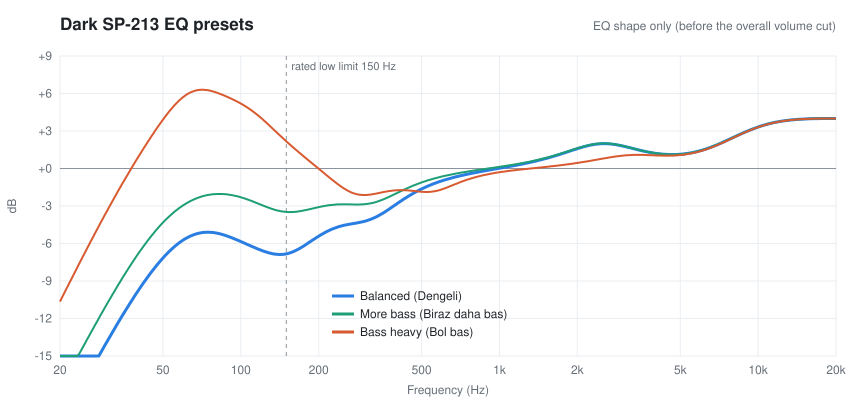

**Türkçe için: [README.tr.md](README.tr.md)** · English below

# Better sound for Dark SP-213 speakers

The Dark SP-213 is a cheap 2.1 speaker set (11 W: a 5 W sub and two 3 W satellites), sold mostly in Turkey. Out of the box it's boomy and muffled: the sub drowns everything, voices are hard to make out, and there's no bass or treble knob to fix it. That's also the most common complaint in store reviews.

This repo fixes it on Windows with the free [Equalizer APO](https://sourceforge.net/projects/equalizerapo/). After a few minutes of setup:

- **No more boom.** The bass is still there, it just stops drowning everything else.
- **Voices and dialogue come forward.**
- **The top end opens up**, so you hear more detail.
- **Less distortion when loud.** The tiny amp stops wasting power on deep bass the sub can't play anyway.

Nothing on the speakers changes; it's all done on the PC. That means it only works on Windows, not when the speakers are plugged into a phone or TV.

## Quick install

1. Install [Equalizer APO](https://sourceforge.net/projects/equalizerapo/). When its Device Selector opens, tick the output the speakers are plugged into, then restart the PC.
2. Download `dark-sp213-eq-v….zip` from the [latest release](https://github.com/Z4RU5/dark-sp213-eq/releases/latest). Right-click the ZIP > **Extract All**.
3. In the extracted folder, right-click `install.ps1` > **Run with PowerShell** (on Windows 11 it may be under **Show more options**), and pick a preset.

Step by step with troubleshooting: **[TUTORIAL.md](TUTORIAL.md)**

## Presets

| Preset | For |
| --- | --- |
| **Balanced** (recommended) | Clear voices, bass without the boom. Best for most music, videos, and games. |
| **More bass** | A bit fuller in the low end, still clear. |
| **Bass heavy** | Boosts bass instead of taming it. Boomy, and can distort at high volume. |

You can switch presets any time by running `install.ps1` again. Option 4 removes the EQ.

## What does `install.ps1` do?

It's a short, readable script; open it in Notepad if you want to check. It:

1. Copies the preset you pick to Equalizer APO's config folder as `dark-sp213.txt`.
2. Backs up Equalizer APO's `config.txt` once (as `config.before-dark-sp213.txt`), then makes it load `dark-sp213.txt`. A fresh Equalizer APO install comes with a demo bass boost in `config.txt`, which would otherwise stack with this EQ.

That's all. It doesn't download anything, doesn't install anything, and leaves nothing running in the background. It only asks for admin rights if Equalizer APO's folder isn't writable. If you'd rather not run a script, the [manual install](TUTORIAL.md#if-the-script-wont-run-manual-install) is three steps.

## What the Balanced preset does

The maker rates the SP-213 down to only 150 Hz, and the 5 W sub can't play real deep bass. The factory tuning still pushes the bass region hard, so you get boom instead of bass.

| Change | Why |
| --- | --- |
| Cut below 65 Hz | The sub can't play it; it only causes distortion |
| −2 dB at 100 Hz, −5 dB at 150 Hz | Removes the boom, the main problem |
| −2.5 dB at 320 Hz | Removes the muffled, "boxy" sound |
| +2 dB at 2.5 kHz | Voices and dialogue |
| +4 dB above 7.5 kHz | Detail and air |
| −5 dB overall | Headroom, so the boosts never clip. Turn the speaker knob up to make up for it. |

## Other tips

- **Faint hiss or buzz when nothing is playing?** Plug the speakers' USB power cable into a phone charger or your modem's USB port instead of the PC. Reviewers who tried it say the noise goes away.
- **Keep the sub away from walls and corners.** Walls make bass boomier. Some reviewers also find it sounds clearer with all three pieces side by side.
- **Leave Windows volume high (80-100%)** and set the loudness with the speaker knob.

## Other speakers

It will probably help similar cheap 2.1 sets too (Dark SP-211, SP-214, and others), but those haven't been tested. If you try it, tell others how it went in [Issues](../../issues).

## License

[MIT](LICENSE). Use it, change it, share it.
